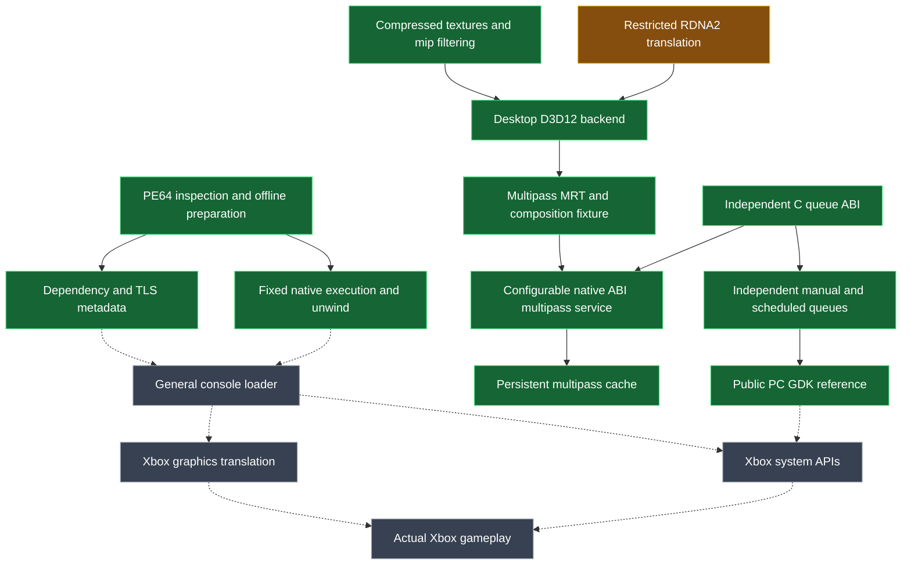
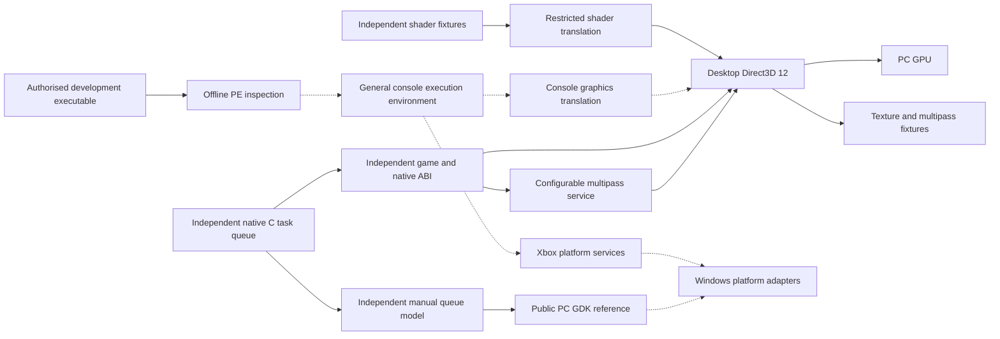

<div align="center">

# R E V E N G E

### Native Xbox Series X|S compatibility research for Windows

**Native execution. Hardware-adaptive graphics. Performance first.**


[Overview](#overview) · [Development progress](#development-progress) · [Roadmap](#roadmap) · [Changelog](CHANGELOG.md) · [Build](#building-revenge) · [Usage](#using-revenge) · [Contributing](#contributing) · [Legal](LEGAL.md) · [Licence](LICENSE)

</div>

> [!IMPORTANT]
> Revenge Native is an independent research project, not a playable Xbox Series X|S emulator. General console executable loading, Xbox platform APIs and console graphics translation are not implemented.

## Overview

Revenge Native investigates native x86-64 execution and translation of Xbox Series X|S platform interfaces on Windows using an independent C++20 codebase. It aims to use existing PC hardware wherever appropriate rather than emulate every component of a console.

The project targets desktop Direct3D 12, vendor-adaptive GPU detection and RDNA2 shader recompilation. The initial gameplay performance goal is 10 FPS for supported console development applications; this is not a measured Xbox gameplay result.

## Development progress

### Current release: v0.68.0

The following diagram shows the state of the main components, rather than an arbitrary percentage of the entire project.



🟢 **Implemented and tested (within stated scope)** · 🟡 **Partial or Windows/GPU validation pending** · ⚪ **Planned / incomplete**

| **Subsystem** | **Progress** | **Current implementation** |
| --- | --- | --- |
| PE32+ executable inspection | 🟢 Tested | Headers, sections, imports, exports, delay imports and bounds checks |
| Offline image preparation | 🟢 Tested | Data-buffer mapping, zero fill, DIR64 relocations and page permissions |
| Loader metadata | 🟢 Tested | Recursive direct-import inventory, TLS templates and x64 unwind diagnostics; no general binding |
| Fixed native image execution | 🟢 Tested | Independently authored x64 fixture, fixed host import, Windows unwind registration and stack recovery |
| Dirty-page tracking | 🟢 Tested | Dirty bitmap and contiguous range coalescing |
| Shader inventory | 🟢 Tested | Structural DXBC discovery and SHA-256 deduplication |
| Windows folder picker | 🟡 Partial | Executable selection and offline reports; interactive validation not established here |
| GPU capability detection | 🟢 Tested | Hardware detection and capability reporting on RTX 5070 Ti; AMD/Intel hardware validation outstanding |
| GPU synchronisation | 🟢 Tested | Fence-based submission, resource reuse and verified readback |
| PC shader precompilation | 🟡 Partial | Restricted HLSL translation and cache tooling; full DXIL pipeline not validated |
| Compute shader harness | 🟢 Tested | Known-answer independent Direct3D 12 compute fixtures |
| Native Xbox execution | ⚪ Pending | General import binding, guest TLS, exception environment and console ABI |
| Xbox memory and system APIs | ⚪ Pending | Console memory semantics, ownership and platform services |
| D3D12.X graphics translation | ⚪ Pending | Console-specific device, resources, commands and presentation |
| Native shader recompilation | 🟡 Partial | Restricted RDNA2 ALU, flow, memory and stage fixtures; not general console shaders |
| Texture layout and filtering | 🟢 Tested | Independent layout reference and D3D12 RGBA8/BC1/3/4/5 sampling, mips and arrays; not console tiling |
| Multipass render targets | 🟢 Tested | Two MRTs, depth/stencil, blending, scissor and render-to-texture fixture |
| Persistent multipass cache | 🟢 Desktop CLI tested | Device, queue, fence, two root signatures, four PSOs and one size-keyed resource slot; per-session ABI DLL ownership and GPU reuse need confirmed validation |
| Configurable native ABI multipass | 🟢 Tested | Client-defined dimensions and draw lists, restricted modes, three RGBA8 outputs |
| Public Windows GDK reference | 🟢 Tested | PC lifecycle, manual/delayed queues, duplicate handles and module diagnostics validated on v0.50.0 |
| Independent manual and scheduled queues | 🟢 Tested | Bounded ports, virtual deadlines, duplicate handles, cancellation, capacity, stale handles and API inventory; no GDK ABI |
| Independent C queue ABI | 🟢 Tested (portable additions) | Thread-safe handles, real-time delay, snapshots, tracked pending cancellation, reentrant callbacks and managed-thread CPU rendering; current GPU integration pending |
| Ray tracing | ⚪ Pending | Console acceleration structures and shader translation; hardware capability detection only |
| Audio, input, storage and lifecycle | 🟡 Partial | Independent Windows-backed adapters; physical audio/controller checks incomplete |
| Runtime pipeline cache | 🟡 Partial | Restricted fixture pipeline reuse and compute cache; general persistent graphics cache incomplete |
| Independent game | 🟢 Tested | Revenge Arena desktop sample, not an Xbox title |
| Playable Xbox games and FPS | ⚪ Not demonstrated | Authorised console first frame and gameplay milestones remain outstanding |

### What has been achieved

The v0.67.0 Windows baseline passed 29 focused and seven GPU tests. v0.68.0 adds an offline transitive dependency audit for explicit file inventories, including forwarder reachability and cycle diagnostics. The fixed native loader lifecycle remains unchanged; general guest import binding and static TLS are not implemented. See [loader lifecycle](docs/LOADER_067.md).

These results demonstrate independent executable preparation, fixed native execution, host runtime services and desktop graphics. They do **not** demonstrate execution of an Xbox title or a complete console compatibility layer. No title-specific or protected material is distributed.

See [validation results](docs/VALIDATION.md) and [release history](CHANGELOG.md) for details.

## Architecture



The diagram represents the intended full runtime. Solid connections describe existing independent research paths; dashed connections are future integration work. The desktop graphics backend is not a functioning console-to-PC rendering pipeline.

## Roadmap

- General executable initialisation, guest TLS and exception environment.
- Documented Xbox platform service and graphics interface compatibility.
- Broader shader instruction, resource and command coverage.
- Authorised console-targeted development application validation, followed by gameplay and performance testing.

See [persistent multipass and typed binding](docs/PERSISTENT_052.md) for the new limits and validation.

See [native queue ABI](docs/QUEUE_ABI_051.md) for the trusted-client interface and lifetime rules, [validation and queue extensions](docs/VALIDATION_053.md) for the queue API, and [GPU lifecycle validation](docs/VALIDATION_054.md) for current checks.

## Requirements

| Component | Development requirement |
| --- | --- |
| OS and CPU | Windows 10/11 x64; AMD or Intel x86-64 |
| GPU | Hardware Direct3D 12 adapter supporting feature level 12_0 |
| Compiler | Visual Studio 2022, Desktop development with C++ |
| Windows SDK | 10.0.22621 or newer recommended |
| CMake | 3.20 or newer |
| Python | 3.9+ for shader tooling and tests |
| DXC | Optional for offline shader experiments |
| Public GDK | Optional Windows reference; installed externally, see [guide](docs/PUBLIC_GDK_050.md) |

Linux supports portable core tests, not the Windows GPU backend. NVIDIA, AMD and Intel adapters are detected through standard APIs; physical cross-vendor validation is incomplete.

## Building Revenge

Install [Visual Studio 2022 Build Tools](https://visualstudio.microsoft.com/downloads/) with the C++ desktop workload and [CMake](https://cmake.org/download/). Extract the source, open PowerShell in the project root and run:

```powershell
powershell -ExecutionPolicy Bypass -File .\Build-And-Test-Revenge.ps1
```

This builds the Release configuration, runs automated regression and GPU fixture checks, and writes a `validation.log`. Add `-Play` to launch the independent Revenge Arena sample after validation. For a normal build, use `Build-Revenge.ps1` instead. Rust is not required.

For faster development iterations, keep the existing `build` directory and use `-FastBuild -BuildJobs 2`. This disables interprocedural optimisation while keeping Release optimisation, and builds with two concurrent jobs. Use the same flags on subsequent runs to avoid rebuilding when switching optimisation modes. Reduce to `-BuildJobs 1` if memory pressure or compiler file-access errors occur. Omit `-FastBuild` for the standard optimised build.

For focused development checks, add `-Focused` to the validation command. It builds Revenge, the native ABI library, selected graphics and platform tests, and the optional GDK reference through one aggregate target. It runs selected portable regression tests including the fixed native image fixture, the GDK reference when enabled, and separately runs seven required desktop GPU comparisons. Each GPU check requires a successful exit and verification output. It does not certify the full suite. Run the command without `-Focused` for complete validation. When updating from an exact previous release, the optional incremental source archive replaces only changed files, preserving other source timestamps and existing build outputs.

The installed public GDK is detected via `GameDKCoreLatest`, `GameDK`, or the standard Program Files installation roots. Use `-GdkRoot "C:\Program Files (x86)\Microsoft GDK\261000"` to select an explicit SDK, or `-SkipGdk` to disable the optional reference. No SDK files are copied into Revenge.

## Using Revenge

```powershell
.\build\Release\Revenge.exe --help
.\build\Release\Revenge.exe gpu-info
.\build\Release\Revenge.exe gdk-api-registry
.\build\Release\Revenge.exe inspect .\build\Release\RevengePlatformProbe.exe
.\build\Release\Revenge.exe target-plan .\build\Release\RevengePlatformProbe.exe
```

Native clients can call `RV_PASS_RENDER` for bounded desktop multipass rendering; see [the service contract](docs/MULTIPASS_048.md).

The diagnostic commands inspect executable metadata without executing the inspected file. The native Windows process runner uses the normal OS loader and is not an Xbox execution environment or security sandbox. Use only trusted, authorised development files.

## Project structure

```text
Revenge/
├── CMakeLists.txt
├── Build-Revenge.ps1
├── Build-And-Test-Revenge.ps1
├── include/revenge/
├── src/
├── samples/
├── tests/
├── tools/
├── docs/
├── README.md
├── CHANGELOG.md
├── CONTRIBUTING.md
├── LEGAL.md
├── THIRD_PARTY_NOTICES.md
└── LICENSE
```

## Contributing

Read [CONTRIBUTING.md](CONTRIBUTING.md) and [LEGAL.md](LEGAL.md). Include the version, hardware, exact command, validation log and a minimal authorised fixture in reproducible bug reports. Do not submit commercial binaries, protected packages, private SDK material or credentials.

## Documentation and licence

- [Release history](CHANGELOG.md)
- [Architecture](docs/ARCHITECTURE.md)
- [Validation](docs/VALIDATION.md)
- [Third-party notices](THIRD_PARTY_NOTICES.md)
- [GPL-3.0-or-later licence](LICENSE)

Revenge is independent and not affiliated with Microsoft, Xbox or any hardware vendor or game publisher. Original source is licensed under GPL-3.0-or-later. The project does not distribute game files, confidential SDK components, firmware or encryption keys, and does not aim to bypass licensing or authentication. See [LEGAL.md](LEGAL.md) for the full policy.
