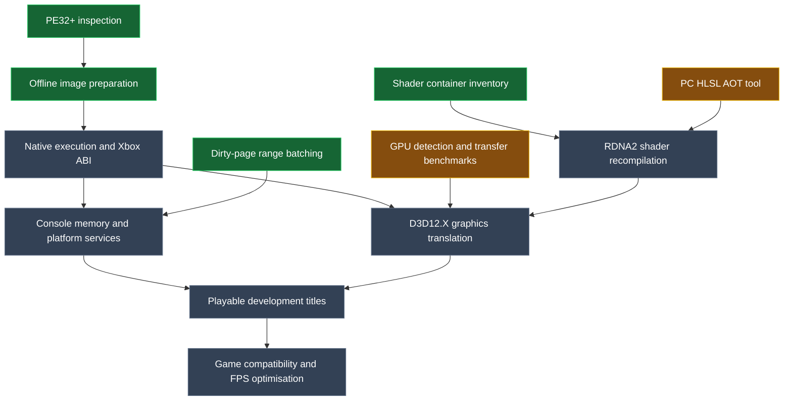
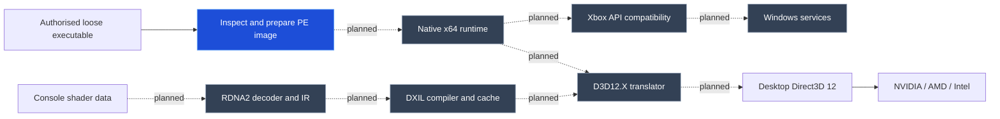

<div align="center">

# R E V E N G E

### Native Xbox Series X|S compatibility research for Windows

**Native execution. Hardware-adaptive graphics. Performance first.**


[Overview](#overview) · [Development progress](#development-progress) · [Roadmap](#roadmap) · [Build](#building-revenge) · [Usage](#using-revenge) · [Contributing](#contributing) · [Legal](LEGAL.md) · [Licence](LICENSE)

</div>

> [!IMPORTANT]
> **Revenge Native is currently a research and development project, not a playable Xbox Series X|S emulator.** Version 0.6.0 can inspect and prepare console executables offline, but cannot execute Xbox game code. The graphics ABI translator and native shader recompiler are still under development. No commercial game has been demonstrated to run in this version.

## Overview

Revenge is an independent C++20 compatibility-layer project designed to investigate running native Xbox Series X|S (Scarlett) games on Windows PCs by executing compatible x86-64 code directly and translating console-specific graphics, memory and operating-system interfaces.

Rather than emulating every component of an Xbox console, the goal is to use existing PC hardware and Windows APIs wherever their behaviour is compatible, while implementing the missing console functionality separately. Xbox Series consoles and modern Windows PCs share an x86-64 CPU architecture, but differ in their graphics interfaces, GPU shader formats, memory architecture and platform services.

Revenge began as an experiment with existing compatibility-layer approaches. The current **Revenge Native** branch is an independent rewrite, with its own C++ codebase, executable preparation tools, graphics experiments and validation tests. It does not include the earlier Rust fork's implementations and does not yet match their feature set.

### Project goals

- Preserve original game logic through native x86-64 execution wherever possible.
- Translate Xbox-specific Direct3D 12.X interfaces to desktop Direct3D 12.
- Recompile console-native RDNA2 shaders to PC-compatible shader code.
- Support NVIDIA, AMD and Intel graphics through runtime capability detection, without requiring separate vendor builds.
- Reduce CPU/GPU stalls, redundant memory transfers and shader compilation overhead.
- Build a persistent shader and pipeline cache with ahead-of-time preparation.
- Provide a straightforward Windows launcher and detailed diagnostics.
- Expand compatibility using repeatable tests, not title-specific shortcuts alone.

The initial performance goal is **10 FPS (100 ms per frame)** in supported games. The longer-term ambition is stable 30–60 FPS where hardware and compatibility permit. These are engineering targets, not measured results or guarantees for every game.

## Development progress

### Current release: v0.6.0

The following diagram shows the state of the main components, rather than an arbitrary percentage of the entire project.



🟢 **Implemented and tested** · 🟡 **Implemented, Windows/GPU validation pending** · ⚪ **Planned / incomplete**

| Subsystem | Progress | Current implementation |
| --- | :---: | --- |
| PE32+ executable inspection | 🟢 Tested | Headers, sections, named/ordinal imports and bounds checks |
| Offline image preparation | 🟢 Tested | Section mapping into data buffers, zero filling and AMD64 DIR64 relocations |
| Loader metadata | 🟢 Tested | Direct IAT slot inventory, basic TLS and exception-table validation |
| Dirty-page tracking | 🟢 Tested | Dirty bitmap and contiguous range coalescing |
| Shader inventory | 🟢 Tested | Structural DXBC discovery and SHA-256 deduplication |
| Windows folder picker | 🟡 Pending validation | Executable selection and offline preparation reports |
| GPU capability detection | 🟡 Pending validation | DXGI adapter selection, vendor, UMA, memory and feature reporting |
| GPU synchronisation | 🟡 Pending validation | Standalone fence-based submission ring and verified-readback benchmark design |
| PC shader precompilation | 🟡 Pending validation | Parallel HLSL-to-DXIL compilation and persistent integrity-checked cache |
| Compute shader harness | 🟡 Pending validation | Known-answer Direct3D 12 compute test |
| Native Xbox execution | ⚪ Pending | Import binding, TLS startup, unwind registration and console ABI |
| Xbox memory and system APIs | ⚪ Pending | Physical memory semantics, resource ownership and platform services |
| D3D12.X graphics translation | ⚪ Pending | Device, resources, descriptors, command lists, queues and presentation |
| Native shader recompilation | ⚪ Pending | RDNA2 decoding, intermediate representation, DXIL emission and validation |
| Texture layout and ray tracing | ⚪ Pending | Console tiling conversion and compatible PC acceleration structures |
| Audio, input, storage and lifecycle | ⚪ Pending | Windows-backed platform adapters |
| Runtime pipeline cache | ⚪ Planned | Adapter/driver-specific PSO persistence |
| Playable games and FPS | ⚪ Not demonstrated | First-frame and gameplay milestones remain outstanding |

### What has been achieved

The current native codebase has passed a Linux C++20 Release build, its CTest suite and two Python shader tests. The portable tests exercise executable preparation using synthetic fixtures, including base relocations, IAT metadata and bounds validation.

These results demonstrate executable **preparation**, not execution. The mapped image is a non-executable data buffer; no imports are bound and no callbacks or title entry point are invoked. Title-specific diagnostic data is not distributed in this public snapshot.

See [validation results](docs/VALIDATION.md) for details. Windows MSVC compilation, DXC integration and GPU execution have not yet been validated for this release.

## Architecture



The diagram represents the intended full runtime. Dashed connections are future integration work; the current build contains standalone PC graphics and shader tools, not a functioning console-to-PC rendering pipeline.

### Performance strategy

The main areas of research are reducing unnecessary synchronisation, avoiding redundant CPU-to-GPU uploads, parallelising independent shader compilation, reusing translated shaders and pipelines, and exploiting actual adapter capabilities instead of assuming a fixed GPU vendor or memory architecture.

The initial frame-time budget is:

| Subsystem | Proposed budget | Allocation |
| --- | ---: | --- |
| CPU translation and submission | 30 ms | `██████░░░░░░░░░░░░░░` |
| Memory and transfer management | 15 ms | `███░░░░░░░░░░░░░░░░░` |
| GPU rendering | 45 ms | `█████████░░░░░░░░░░░` |
| Other overhead | 10 ms | `██░░░░░░░░░░░░░░░░░░` |
| **Total** | **100 ms** | **10 FPS target** |

These are planning allocations, not benchmark measurements. CPU/GPU overlap means the end-to-end critical path matters more than a simple sum. Performance will be assessed using actual presented frames, frame-time percentiles, shader cache hits, fence stalls, transfer volume and visual correctness.

## Roadmap

| Milestone | Goal | Status |
| --- | --- | :---: |
| M1 | Portable PE inspection and offline preparation | 🟢 Initial implementation tested |
| M2 | Windows builds and hardware/compute validation | 🟡 Awaiting validation |
| M3 | Execute a small authorised x64 development fixture | ⚪ Planned |
| M4 | Console memory, threading, storage and ABI support | ⚪ Planned |
| M5 | RDNA2 shader decoding and validated PC shader generation | ⚪ Planned |
| M6 | D3D12.X graphics translation and first rendered triangle | ⚪ Planned |
| M7 | Textures, descriptor lifetimes, ray tracing and presentation | ⚪ Planned |
| M8 | Input, audio, save data and playable development titles | ⚪ Planned |
| M9 | Per-title compatibility and shader/pipeline cache integration | ⚪ Planned |
| M10 | Sustained 10 FPS target and cross-vendor performance tuning | ⚪ Planned |

The next milestone is to validate the Windows graphics harness and establish a correct native execution path with a small, self-authored or otherwise authorised Xbox development fixture. Full commercial titles will be evaluated only after the underlying interfaces are validated.

## Hardware and software requirements

These are **development requirements**, not a final game compatibility specification.

| Component | Requirement |
| --- | --- |
| Operating system | Windows 10/11 x64 target; Windows validation pending |
| CPU | x86-64 AMD or Intel processor |
| GPU | Hardware Direct3D 12 adapter supporting feature level 12_0 for current GPU tools |
| Graphics driver | Up-to-date compatible driver |
| Compiler | Visual Studio 2022 with Desktop development with C++ (MSVC v143) |
| Windows SDK | 10.0.22621 or newer recommended |
| CMake | 3.20 or newer |
| Python | 3.9+ (3.11+ recommended), for shader tools and Python tests |
| DXC | Optional; required for HLSL-to-DXIL experiments |

The runtime is designed to use standard DXGI/D3D12 interfaces and automatically select a suitable adapter, reporting NVIDIA, AMD or Intel vendor information and relevant capabilities. Vendor compatibility is not yet verified on physical hardware. Linux is supported for portable core tests only; the GPU backend is a stub on non-Windows builds.

## Building Revenge

### 1. Install the prerequisites

Install [Visual Studio 2022 Build Tools](https://visualstudio.microsoft.com/downloads/) with **Desktop development with C++**, including the MSVC x64 toolchain and Windows SDK. Install [CMake](https://cmake.org/download/) as well. An existing Visual Studio installation with the same workload is sufficient.

Alternatively, install CMake using PowerShell:

```powershell
winget install --id Kitware.CMake -e
```

Close and reopen PowerShell after installation. Verify CMake is available:

```powershell
cmake --version
```

For shader experiments, install [Python](https://www.python.org/downloads/) and download the [DirectX Shader Compiler](https://github.com/microsoft/DirectXShaderCompiler/releases). Keep `dxc.exe` and its accompanying DLLs together.

### 2. Download the source

Use **Code → Download ZIP** on GitHub, or clone the repository using its GitHub clone URL. Extract or open the project directory containing `CMakeLists.txt` and `Build-Revenge.ps1`.

### 3. Compile for Windows x64

Open PowerShell in the project directory:

```powershell
powershell -ExecutionPolicy Bypass -File .\Build-Revenge.ps1
```

The script searches for CMake, configures the Visual Studio 2022 x64 generator, builds Release and runs the C++ tests. If CMake or the build toolchain is missing, install the corresponding component before retrying.

The expected output is:

```text
build\Release\Revenge.exe
```

#### Manual CMake build

```powershell
cmake -S . -B build -G "Visual Studio 17 2022" -A x64
cmake --build build --config Release --parallel
ctest --test-dir build -C Release --output-on-failure
```

### 4. Verify the build

```powershell
.\build\Release\Revenge.exe --version
.\build\Release\Revenge.exe --help
```

Rust is not required for Revenge Native.

## Using Revenge

### Windows folder selection

Double-click `Revenge.exe`, or run:

```powershell
.\build\Release\Revenge.exe browse
```

Select a directory containing an authorised loose executable. If multiple executables are present, choose the intended file.

- A detected Scarlett executable is prepared offline and a report is written to `%TEMP%\Revenge-loader-report.txt`. No Xbox game code is executed.
- An ordinary Windows executable without known console markers may be launched directly by Windows after confirmation. This is not Xbox emulation.
- Detection is heuristic. Only select trusted files.

### Inspect and prepare an executable

```powershell
.\build\Release\Revenge.exe inspect 'C:\Games\Test\game.exe'
.\build\Release\Revenge.exe prepare 'C:\Games\Test\game.exe'
.\build\Release\Revenge.exe prepare 'C:\Games\Test\game.exe' --rebase
```

`inspect` reports executable headers, sections and direct imports. `prepare` performs offline image preparation; `--rebase` tests relocation to an alternate virtual base without reserving that address in Windows. The current CLI accepts PE32+ files up to 512 MiB; use ASCII paths for CLI compatibility. Delay-loaded, dynamic and transitive imports are not included.

### GPU detection and benchmarks

```powershell
.\build\Release\Revenge.exe gpu-info
.\build\Release\Revenge.exe gpu-bench 240 1 4
.\build\Release\Revenge.exe gpu-bench 240 3 4
.\build\Release\Revenge.exe mem-bench
```

The GPU benchmark compares 240 iterations of 4 MiB transfers with one versus three submission slots and checks final readback. The memory benchmark measures synthetic dirty-range processing, not actual GPU transfer throughput. Neither command measures game FPS.

### Shader research tools

Discover structurally recognisable, uncompressed DXBC containers in an authorised directory:

```powershell
py -3 tools\shaders.py scan 'C:\Games\Test' --out shader-inventory.json
```

Compile the included HLSL sample ahead of time using parallel DXC workers and a dedicated fresh cache:

```powershell
py -3 tools\shaders.py compile samples\shaders.json --dxc 'C:\Tools\dxc\bin\x64\dxc.exe' --cache cache\sample-hlsl --jobs 6
$shader = (Get-ChildItem .\cache\sample-hlsl\*.dxil | Select-Object -First 1).FullName
.\build\Release\Revenge.exe gpu-compute $shader
```

Use a fresh sample cache and only the provided known-answer shader for `gpu-compute`. It expects a particular UAV layout and arithmetic. The compiler cache includes preprocessed source, compiler identity, entry point, target and optimisation settings; stored output hashes are checked before reuse.

> [!NOTE]
> PC HLSL compilation is not Xbox shader translation. The current scanner does not decode packed archives or native RDNA2 shader instructions, and the shader tool is not a runtime game pipeline cache. Real DXC and GPU integration remain untested.

## Project structure

```text
Revenge/
├── CMakeLists.txt            # C++20 build configuration
├── Build-Revenge.ps1         # Windows build and test script
├── include/revenge/         # Public core, loader and launcher interfaces
├── src/
│   ├── main.cpp              # CLI and benchmark entry points
│   ├── pe.cpp                # PE32+ inspection
│   ├── loader.cpp            # Offline image preparation
│   ├── pages.cpp             # Dirty-page range batching
│   ├── launch.cpp            # Executable selection and console markers
│   ├── launch_win.cpp        # Windows folder selection
│   ├── gpu_win.cpp           # Direct3D 12 probes and benchmarks
│   └── gpu_stub.cpp          # Non-Windows GPU stub
├── tools/shaders.py         # Shader inventory and PC HLSL compiler
├── samples/                 # Known-answer HLSL fixture
├── tests/                   # C++ and Python tests
├── docs/                    # Architecture and validation notes
├── LICENSE                  # GNU GPL v3 licence text
├── LEGAL.md                 # Development and distribution policy
├── CONTRIBUTING.md          # Contribution and provenance rules
├── THIRD_PARTY_NOTICES.md   # Dependency and reference register
└── .gitignore               # Local files excluded from version control
```

## Testing

On Windows, the build script runs CTest. Run the Python suite separately:

```powershell
ctest --test-dir build -C Release --output-on-failure
py -3 tests\test_shaders.py
```

On Linux, build the portable core and run its tests:

```bash
cmake -S . -B build -DCMAKE_BUILD_TYPE=Release
cmake --build build --parallel
ctest --test-dir build --output-on-failure
python3 tests/test_shaders.py
```

The portable test suite covers PE import parsing, range validation, relocation fixups and rejection of unsupported relocations, IAT slot indexing, dirty-page tracking, executable candidate selection and shader-container inventory/deduplication. See [validation](docs/VALIDATION.md).

## Contributing

Read [CONTRIBUTING.md](CONTRIBUTING.md) and [LEGAL.md](LEGAL.md) before submitting changes. Document source provenance and preserve all required notices.

Useful areas for future work include C++ systems programming, Windows PE/ABI research, Direct3D 12, GPU shader compilation, AMD RDNA2 ISA, memory management and performance profiling.

For a reproducible bug report or performance contribution, include:

- Revenge version, operating system, CPU, GPU and driver version.
- Exact command and error or unexpected result.
- `gpu-info` output and relevant benchmark results.
- A minimal, authorised test fixture and expected output, if available.
- For performance changes, comparable before/after measurements and evidence that rendering correctness is preserved.

Please do not submit copyrighted commercial game binaries, protected packages, private SDK material, credentials, or personal file paths in public issues. Small self-authored development samples with corresponding Windows and Scarlett builds are particularly valuable.

## Research and references

Revenge draws architectural research from public graphics and executable documentation, and studies other compatibility projects as references. These links do not imply shared code, affiliation or feature parity.

- [Microsoft GDK](https://github.com/microsoft/GDK) and [Xbox GDK samples](https://github.com/microsoft/Xbox-GDK-Samples)
- [Microsoft PE format specification](https://learn.microsoft.com/en-us/windows/win32/debug/pe-format)
- [AMD GPU ISA specifications](https://gpuopen.com/machine-readable-isa/)
- [Microsoft DirectX Shader Compiler](https://github.com/microsoft/DirectXShaderCompiler)
- [DirectX specifications](https://github.com/microsoft/DirectX-Specs)
- [Direct3D 12 fence-based resource management](https://learn.microsoft.com/en-us/windows/win32/direct3d12/fence-based-resource-management)
- [Xenia](https://github.com/xenia-project/xenia), [shadPS4](https://github.com/shadps4-emu/shadPS4) and [vkd3d-proton](https://github.com/HansKristian-Work/vkd3d-proton) — architectural references for other platforms and graphics APIs

Further technical details are available in [docs/ARCHITECTURE.md](docs/ARCHITECTURE.md).

## Disclaimer and licensing

Revenge is an independent research project and is not affiliated with Microsoft, Xbox, NVIDIA, AMD, Intel or any game publisher. Their names and trademarks belong to their respective owners. Revenge does not distribute game files, confidential SDK components, firmware or encryption keys. Use only software and development materials you are authorised to access. The project does not aim to bypass licensing or authentication systems.

Original Revenge Native source is licensed under the **GNU General Public License, version 3 or (at your option) any later version (GPL-3.0-or-later)**. See [LICENSE](LICENSE) for the full licence. Third-party material remains subject to its applicable terms; see [THIRD_PARTY_NOTICES.md](THIRD_PARTY_NOTICES.md).

The Native branch is an independent reimplementation, not a formally audited two-team clean-room project. Revenge does not accept DRM circumvention, protected retail-package decryption, console key extraction, hypervisor bypass or unauthorised authentication bypass contributions. See [LEGAL.md](LEGAL.md) for project boundaries and [CONTRIBUTING.md](CONTRIBUTING.md) for provenance and testing requirements.

The policy and licence are not a guarantee of legal compliance. Contributors and distributors must verify their rights, applicable agreements and local law.

---

<div align="center">

**REVENGE — building toward native execution, accurate translation and measurable performance.**

</div>
